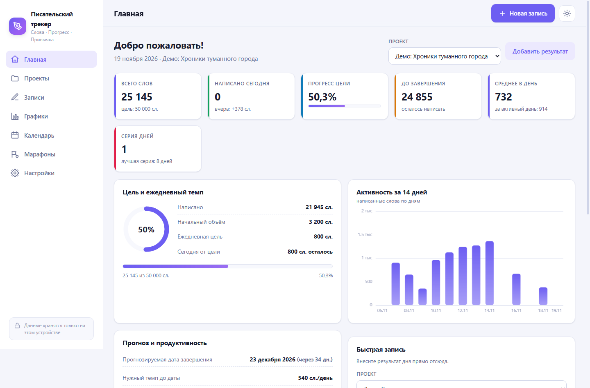
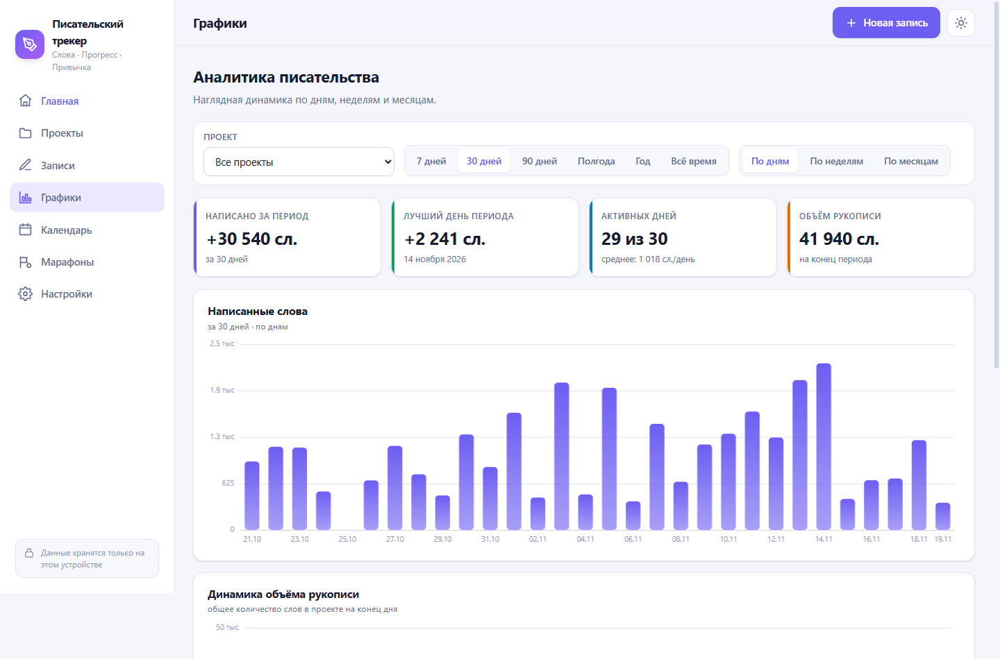
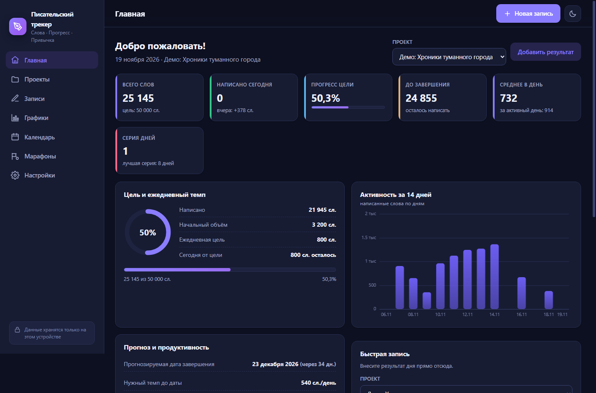
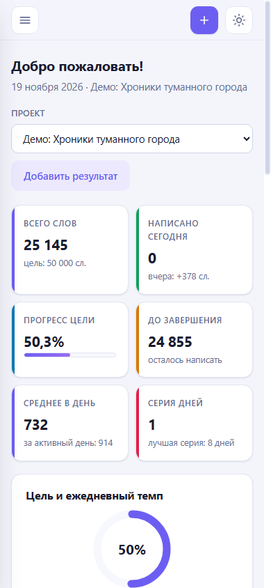

# Писательский трекер (Writer Tracker)

  

Автономное веб-приложение для учёта написанных слов, отслеживания прогресса литературных
проектов и анализа писательской активности. Вдохновлено возможностями статистики
NaNoWriMo, но является самостоятельным продуктом.

Приложение полностью работает **офлайн**: без серверов, фреймворков, сборщиков и CDN.
Все данные хранятся локально в браузере (IndexedDB, с автоматическим резервированием
на localStorage) и никогда не покидают устройство.



## Содержание

- [Возможности](#возможности)
- [Быстрый старт](#быстрый-старт)
- [Использование](#использование)
- [Запуск](#запуск)
- [Публикация на GitHub Pages](#публикация-на-github-pages)
- [Структура проекта](#структура-проекта)
- [Модель данных](#модель-данных)
- [Резервные копии](#резервные-копии)
- [Ограничения локального хранения данных](#ограничения-локального-хранения-данных)
- [Автотесты и результаты тестирования](#автотесты-и-результаты-тестирования)
- [Лицензия](#лицензия)

## Возможности

### Управление проектами
- Несколько литературных проектов одновременно.
- Для каждого проекта: название, описание, жанр, цветовая метка, целевое количество слов,
  начальный объём текста (для уже начатых рукописей), дата начала, планируемая дата
  завершения, индивидуальная ежедневная цель и статус (активный / завершённый / архивный).
- Создание, редактирование, архивирование и удаление (с защитой от случайного удаления:
  требуется ввести название проекта).

### Учёт написанных слов
Два режима ввода, которые можно свободно смешивать — двойного счёта не будет:
1. **Написано за день** — указывается прирост слов за выбранную дату (можно отрицательный,
   для правок).
2. **Общий объём рукописи** — указывается текущее число слов; приложение само рассчитывает
   разницу с предыдущим значением, включая сокращения текста.

Реализован последовательный пересчёт: «общий объём» задаёт уровень рукописи, «за день»
прибавляется к нему. При редактировании и удалении записей вся статистика пересчитывается
автоматически. Поддерживаются записи за прошедшие и будущие даты, заметки, фильтры
по проекту / режиму / тексту.

### Статистика
- Общее количество слов, слова за сегодня и вчера.
- Прогресс цели в процентах и количество слов до завершения.
- Среднее количество слов в день и за активный день.
- Самый продуктивный день и количество дней с активностью.
- Текущая и самая длинная серии продуктивных дней.
- Прогнозируемая дата завершения проекта.
- Необходимый ежедневный темп для выполнения цели в срок.

### Графики и календарь
- Столбчатый график написанных слов по дням / неделям / месяцам.
- График динамики общего объёма рукописи.
- Сводка по неделям и месяцам.
- Календарь писательской активности в виде цветных квадратов (с подсказками и легендой).
- Выбор периода просмотра: 7 / 30 / 90 / 180 дней, год, всё время.
- Подсказки со статистикой при наведении на любой график.

Всё рисуется на canvas и DOM — никаких внешних библиотек, интернет не требуется.



### Писательские марафоны
- Собственные челленджи: название, дата начала и окончания, целевое количество слов, проект.
- Прогресс марафона, оставшееся количество слов, необходимый темп, средний темп,
  оставшиеся дни.

### Интерфейс
- Современный адаптивный дизайн: компьютеры, планшеты, телефоны (боковое меню превращается
  в выдвижную панель, таблицы — в карточки).
- Светлая и тёмная темы (плюс режим «системная»), переключатель в верхней панели.
- Боковая навигация: Главная, Проекты, Записи, Графики, Календарь, Марафоны, Настройки.
- Карточки статистики, прогресс-бары, кольцо цели, удобные формы с предпросмотром
  «сколько слов будет засчитано».
- Уведомления об успешных действиях.




### Надёжность
- Данные хранятся локально (IndexedDB; при недоступности — автоматический откат на
  localStorage, в том числе при запуске через `file://` в отдельных браузерах).
- Резервное копирование всех данных в один JSON-файл.
- Импорт с проверкой структуры файла: некорректные файлы отклоняются с перечнем ошибок,
  возможные проблемы помечаются предупреждениями.
- Режимы импорта: «объединить с текущими» (по умолчанию, без потерь) и «полностью
  заменить» (требует явного подтверждения вводом слова ЗАМЕНИТЬ).
- Удаление любого объекта требует подтверждения; удаление проекта — ввода его названия;
  полная очистка данных — ввода слова УДАЛИТЬ.
- Корректно обрабатываются дни без записей, отрицательный прирост слов (сокращения),
  будущие даты и изменение целей.

## Быстрый старт

1. Откройте `index.html` двойным щелчком в браузере — или воспользуйтесь
   [опубликованной версией](#публикация-на-github-pages).
2. Нажмите **«Создать проект»** и укажите цель по количеству слов и даты.
3. Вносите результаты кнопкой **«Новая запись»** — за день или общим объёмом рукописи.
4. Следите за прогрессом на главной странице, в графиках и календаре.
5. Регулярно сохраняйте резервную копию: **Настройки → Скачать JSON**.

Хотите познакомиться с возможностями быстрее? **Настройки → Загрузить демо-данные**
создаст учебный проект с записями, графиком активности и марафоном.

## Использование

### Главная
Сводка по выбранному проекту (или по всем сразу): всего слов, слова за сегодня,
прогресс цели, остаток, средние значения, серии дней. Здесь же — кольцо цели,
мини-график за 14 дней, прогноз завершения и форма быстрой записи.

### Проекты
Карточки проектов с прогрессом, дедлайнами и ежедневной целью. Действия: «Запись»
(быстро добавить результат), «Изменить», «В архив» / «Вернуть», удаление.

### Записи
Полная история с фильтрами по проекту, режиму и тексту. Каждая строка показывает
и введённое значение, и реально засчитанный прирост (например, `−500` при сокращении
рукописи). Записи можно редактировать и удалять — статистика пересчитается сама.

### Графики
Переключатели периода (7 дней — всё время) и группировки (по дням / неделям / месяцам),
столбчатый график слов, график объёма рукописи, недельные и месячные сводки.
Наведение на график показывает точные цифры.

### Календарь
Цветные квадраты за год: чем ярче день, тем больше написано (ориентир — ежедневная
цель). Ниже — таблица по месяцам: написано, активных дней, среднее, лучший день.

### Марафоны
Личные челленджи с расчётом прогресса, остатка слов и необходимого темпа.

### Настройки
Тема оформления, экспорт и импорт JSON, демо-данные, сведения о хранилище
и полная очистка данных (с подтверждением).

## Запуск

### Локально, без сервера
Просто откройте `index.html` двойным щелчком в браузере (Chrome, Edge, Firefox, Safari, Opera).

### Локальный сервер (по желанию)
```bash
cd writer-tracker
python -m http.server 8080
# затем откройте http://localhost:8080/
```

Никакой сборки и установки зависимостей не требуется. Поддерживаются современные
версии браузеров (Chrome, Edge, Firefox, Safari 14+, Opera) на настольных и мобильных
устройствах.

## Публикация на GitHub Pages

Приложение полностью статическое: все пути к ресурсам относительные, маршрутизация
построена на hash-адресах (`#/charts`), поэтому специальная конфигурация сервера
не нужна — GitHub Pages работает «из коробки».

## Структура проекта

```
writer-tracker/
├── index.html          # каркас приложения: разметка, навигация, формы, шапка
├── 404.html            # страница «не найдено» для GitHub Pages
├── css/
│   └── styles.css      # дизайн-система: темы, компоненты, адаптивность
├── js/
│   ├── utils.js        # даты, числа, форматирование, безопасность HTML
│   ├── db.js           # хранилище: IndexedDB + localStorage, экспорт/импорт JSON
│   ├── stats.js        # модель учёта слов и все статистические расчёты
│   ├── charts.js       # canvas-графики и календарь-heatmap с подсказками
│   ├── ui.js           # рендер страниц, формы, модальные окна, тосты
│   └── app.js          # состояние, действия, маршрутизация, обработчики событий
├── tests/
│   └── tests.js        # автотесты логики (7 групп, 60+ проверок)
├── tests.html          # страница запуска автотестов (index.html + раннер)
├── docs/               # скриншоты интерфейса
├── .nojekyll           # отключение Jekyll на GitHub Pages
├── .gitignore          # исключения для git
├── LICENSE             # лицензия Apache-2.0
└── README.md           # этот файл
```

Код разделён на HTML, CSS и JavaScript-файлы и подключается обычными тегами `<script>`
(без ES-модулей), поэтому работает и через `file://`, и на любом статическом хостинге.

## Модель данных

| Сущность  | Ключевые поля |
|-----------|---------------|
| `projects`  | `id`, `name`, `description`, `genre`, `color`, `targetWords`, `initialVolume`, `startDate`, `endDate`, `dailyGoal`, `status`, `createdAt`, `updatedAt` |
| `entries`   | `id`, `projectId`, `date`, `mode` (`daily`/`total`), `value`, `note`, `createdAt`, `updatedAt` |
| `marathons` | `id`, `name`, `projectId`, `start`, `end`, `targetWords`, `note` |
| `settings`  | тема оформления и настройки интерфейса |

Итоговый объём рукописи вычисляется последовательно: `initialVolume` → далее по записям
в порядке дат (и времени создания внутри дня). Запись `daily` прибавляет слова к объёму,
запись `total` задаёт объём напрямую. За счёт этого режимы не конфликтуют.

## Резервные копии

- **Экспорт** (Настройки → «Скачать JSON») создаёт файл вида
  `writer-tracker-backup-ГГГГ-ММ-ДД.json` со всеми данными и настройками.
- **Импорт** (Настройки → «Выбрать файл») сначала проверяет структуру: формат, версию,
  обязательные поля, даты и количество слов. Некорректный файл не импортируется.
  Существующие данные не удаляются без явного подтверждения.
- Файл резервной копии — обычный JSON; его можно открыть в любом редакторе и хранить
  в облаке или на диске. Файлы резервных копий намеренно исключены из git (`.gitignore`),
  чтобы личные данные писателя не попали в публичный репозиторий.

## Ограничения локального хранения данных

Приложение не отправляет данные в интернет — это сознательное решение имеет и оборотную
сторону. Важно понимать следующее:

1. **Данные привязаны к браузеру и устройству.** Проекты, записи и марафоны хранятся
   в хранилище конкретного браузера (IndexedDB / localStorage). На другом компьютере,
   в другом браузере или в режиме инкогнито их не будет.
2. **Данные не синхронизируются.** Открытие сайта с телефона не покажет записи,
   внесённые на ноутбуке. Перенос данных между устройствами — через экспорт/импорт JSON.
3. **Очистка данных браузера удаляет статистику.** Очистка «данных сайтов»,
   переустановка браузера, сброс профиля или удаление данных сайта сотрут все записи.
   Перед этим обязательно сохраните резервную копию.
4. **Приватный режим хранит данные временно.** В режиме инкогнито статистика исчезает
   после закрытия окна.
5. **Браузер может ограничить место.** При нехватке места браузер вправе очистить
   хранилище редко используемых сайтов — ещё одна причина регулярно делать экспорт.
6. **Нет облачного восстановления.** Сервера нет, поэтому утерянный доступ к профилю
   браузера означает утерю данных без резервной копии.

**Рекомендация:** делайте экспорт JSON раз в неделю и после крупных вех
(серия дней, завершённая глава, победа в марафоне).

## Автотесты и результаты тестирования

Страница `tests.html` запускает набор автотестов прямо в браузере (или через headless
Chrome). Тесты не портят пользовательские данные: перед запуском сохраняется резервная
копия, которая восстанавливается по завершении.

```bash
# пример запуска из командной строки
chrome --headless=new --dump-dom --virtual-time-budget=15000 http://localhost:8080/tests.html
```

### Результаты тестирования (19 ноября 2026)

| Группа тестов | Что проверяется | Результат |
|---|---|---|
| Утилиты: даты и форматирование | границы месяцев/годов, начало недели, валидация дат, формат чисел и плюральных форм | PASS |
| Учёт слов: режимы, дельты, отсутствие двойного счёта | дельты `daily`/`total`, отрицательный прирост (сокращение), смешение режимов, пересчёт при удалении и редактировании | PASS |
| Статистика проекта | всего слов, прогресс, остаток, средние, лучший день, серии, прогноз завершения, необходимый темп; расчёты «на дату» | PASS |
| Лента данных | дни без записей, суммы по неделям и месяцам | PASS |
| Марафоны | слова в окне марафона, остаток, темп, дни; исключение записей вне периода | PASS |
| Хранилище | CRUD, экспорт, импорт (replace/merge), валидация корректных и повреждённых файлов, предупреждения | PASS |
| Интерфейс | рендер всех семи разделов, таблицы, графики, календарь, марафоны | PASS |

**Итог: 7/7 групп, 0 ошибок JavaScript** — по HTTP и при запуске через `file://`.

Дополнительно проверено (вручную и через headless Chrome):
- работа из **подпапки** (`/<repo>/index.html`) — сценарий GitHub Pages: все ресурсы
  загружаются по относительным путям, ошибок нет;
- **прямое открытие разделов и обновление страницы** (`index.html#/charts` и др.):
  раздел открывается корректно после F5 и по прямой ссылке;
- страница `404.html` отображается и возвращает в приложение;
- запуск `index.html` двойным щелчком (`file://`), аварийный localStorage-режим;
- создание тестового проекта и записей за разные даты, включая смешение режимов;
- сохранение данных после перезагрузки страницы;
- экспорт JSON и импорт с проверкой файла;
- адаптивность на экране 390×844 — отсутствие горизонтальных переполнений на всех
  семи страницах;
- светлая и тёмная темы.

Замечания, найденные при тестировании и исправленные:
1. зависание приложения при «неотвечающем» IndexedDB — добавлен таймаут с откатом
   на localStorage;
2. учёт будущих записей в статистике «на сегодня» — расчёты ограничены текущей датой;
3. переполнение списка проектов на узких экранах — исправлены правила сжатия;
4. мигание темы при первом запуске — тема применяется до первой отрисовки.

## Лицензия

Проект распространяется под лицензией **Apache License 2.0** — см. файл [LICENSE](LICENSE).
Кратко: свободное использование, копирование и модификация (в том числе в коммерческих
целях) при сохранении уведомления об авторских правах и текста лицензии.

## Приватность

Приложение не содержит обращений к сети: ни аналитики, ни телеметрии, ни внешних
сервисов. Все данные существуют только в хранилище браузера на устройстве посетителя.
Регулярно сохраняйте резервную копию (Настройки → «Скачать JSON»), особенно перед
переустановкой браузера или очисткой его данных.
